<div align="center">

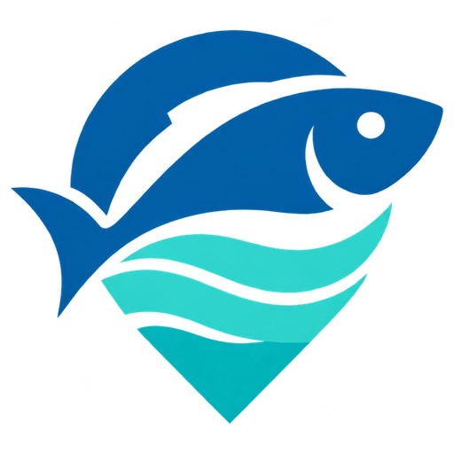

# Palakaya

**Palakaya: A Catch-Logging and Fair-Price Marketplace for Municipal Filipino Fisherfolk**

### *Catch. Connect. Get a Fair Price.*

[](https://swift.org)
[](https://developer.apple.com/xcode/swiftui/)
[](#)
[](#cloud-backend)
[](#7-catch--market-advisor-ai-companion)
[](#)
[](#implementation-status)
[](#license)

*A documented, price-checked alternative to consignacion — one catch at a time.*

</div>

---

## Table of Contents

<details>
<summary>Click to expand</summary>

1. [Overview](#overview)
2. [Background & Problem](#background--problem)
3. [What Palakaya Does](#what-palakaya-does)
4. [Intended Users & Stakeholders](#intended-users--stakeholders)
5. [Core Features](#core-features)
6. [Implementation Status](#implementation-status)
7. [System Illustration](#system-illustration)
8. [Scope & Boundaries](#scope--boundaries)
9. [Tech Stack](#tech-stack)
10. [Architecture (MVC)](#architecture-mvc)
11. [Project Structure — iOS App](#project-structure--ios-app)
12. [Data Models](#data-models)
13. [Cloud Backend](#cloud-backend)
14. [Design System](#design-system)
15. [Figma Prototype](#figma-prototype)
16. [Getting Started](#getting-started)
17. [Roadmap](#roadmap)
18. [References](#references)
19. [License](#license)

</details>

---

## Overview

<div align="center">
  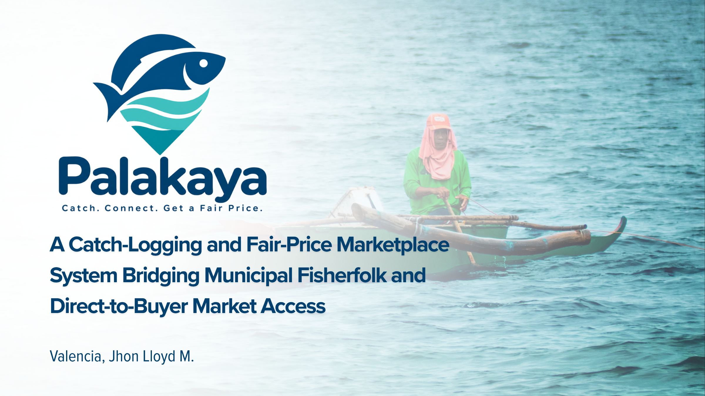
</div>

<br/>

**Palakaya** is a dual-purpose catch-logging and fair-price marketplace system built to close a structural market-access gap facing small-scale Filipino fishers: fishers have no direct channel to reach buyers at a fair, transparent price, and neither the Bureau of Fisheries and Aquatic Resources (BFAR) nor local government fisheries offices have real-time visibility into where catch volumes and market prices are diverging from what fishers actually receive.

The app lets a fisher log each catch by species, weight, fishing ground, and date/time immediately upon landing, checks every listed catch against a rolling **fair-price benchmark**, matches fishers directly with verified buyers, and scores every completed sale for **price alignment** against that benchmark. Every price-checked transaction simultaneously feeds anonymized, aggregated regional data back to BFAR and LGU fisheries offices — the fisher-facing tool *is* the mechanism by which that government-facing data gets collected.

This repository contains:

- **`Palakaya/`**: a native **SwiftUI** iOS app, organized as Model–View–Controller, that works offline with **SwiftData** and syncs to the cloud when there is signal.
- **`supabase/`**: the cloud backend. It has the **Supabase** Postgres schema with row-level security, the marketplace and fair-price views, and the free **AI Advisor** Edge Function (Google Gemini).

> **Capstone Project (BSCS III, 2026)** — Manuel S. Enverga University Foundation, Lucena City
> Valencia, Jhon Lloyd M. · `jhonlloydval@gmail.com`

---

## Background & Problem

<div align="center">
  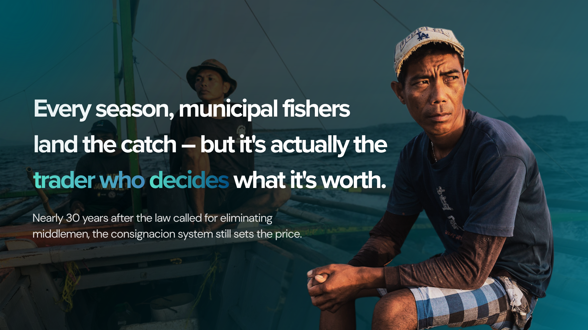
</div>

<br/>

The Philippines is among the most marine-biodiverse nations in the world and has long depended on capture fisheries as a primary source of food, protein, and coastal livelihood. Despite this:

- National fish production declined by almost **600,000 metric tons** between 2010 and 2023, with an estimated **45 million kilos** of fish lost annually to weak law enforcement and governance failures — pushing more than **350,000 fishing families** below the poverty line as of 2023.
- Municipal fishers — the majority of the sector's workforce — rely on the **consignacion system**, in which traders or landing-center operators consolidate and sell catch on consignment, concentrating pricing power with the trader rather than the fisher who bears the risk and labor.
- The Philippine Fisheries Code (**Republic Act No. 8550**) recognized this imbalance as early as 1998, mandating the elimination of middlemen through collective marketing — and the later **Sagip Saka Act (RA 11321)** is itself evidence the problem persists more than two decades on.
- Following the 2026 Iran war, local fuel prices climbed from PHP 400–550 to as high as **PHP 1,200 per 10 liters**, shortening or ending trips for many small-scale fishers despite a one-time PHP 3,000 government subsidy.
- The sector is aging rapidly — the average Filipino fisherman is now **49–52 years old** — amid monthly incomes as low as **PHP 2,500–7,000**, and fishers in contested maritime areas face an added layer of risk that has made some traditional grounds effectively inaccessible.

Prior digital tools show promise but stop short of closing the loop: **ISDApp** delivers offline weather advisories but has no catch logging or market connection; the **Fish Landing app** lets fishers log species and grounds but never connects that data to a buyer; **FishLink**, a locally piloted web app, tested market linkage but remained isolated to a single Misamis Occidental municipality. International platforms like India's **Fisher Friend Mobile Application** and **ABALOBI** have shown that combining catch tracking with direct market linkage can measurably improve a fisher's bargaining position — but no existing tool applies that model to Filipino municipal fisheries specifically.

---

## What Palakaya Does

<div align="center">
  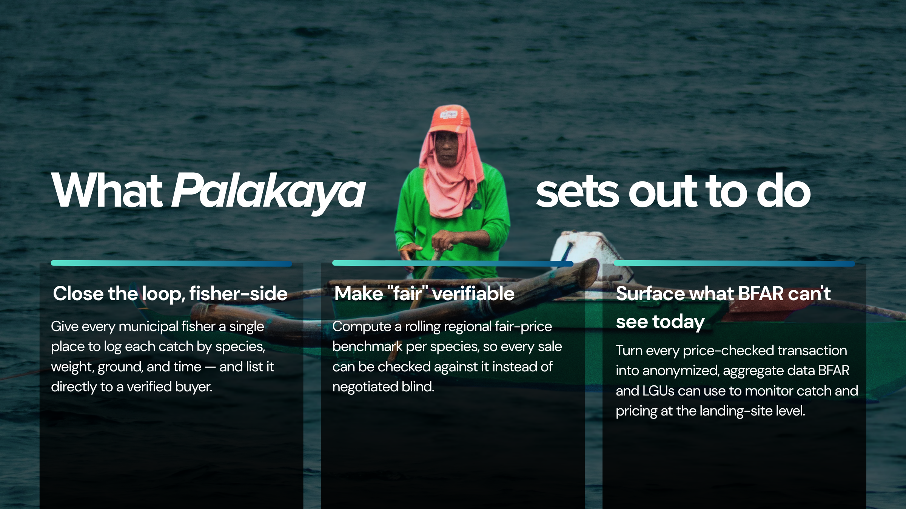
</div>

<br/>

Palakaya closes the gap on both ends:

- **Close the loop, fisher-side** — give every municipal fisher a single place to log each species, weight, ground, and time, and list it directly to a verified buyer.
- **Make "fair" verifiable** — compute a rolling regional fair-price benchmark per species, so every sale can be checked instead of negotiated blind.
- **Surface what BFAR can't see today** — turn every price-checked transaction into anonymized, aggregate data BFAR and LGUs can use to monitor and target support at the landing-site level.

---

## Intended Users & Stakeholders

<div align="center">
  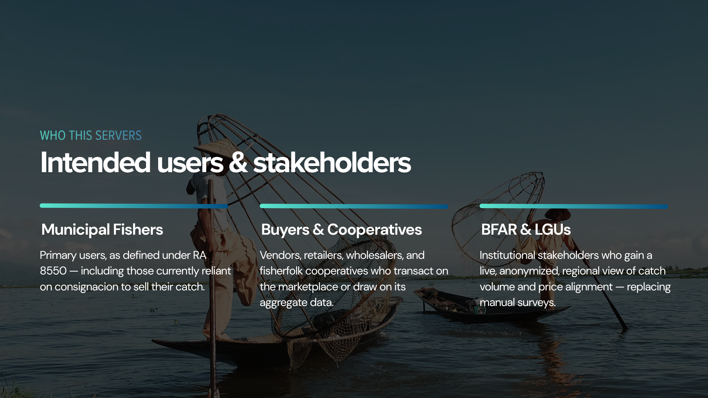
</div>

<br/>

| Group | Role |
|---|---|
| **Municipal Fishers** | Primary users, as defined under RA 8550 — including those currently reliant on consignacion to sell their catch |
| **Buyers & Cooperatives** | Vendors, retailers, wholesalers, and fisherfolk cooperatives who transact on the marketplace or draw on its aggregate data |
| **BFAR & LGUs** | Institutional stakeholders who gain a live, anonymized regional view of catch volume and price alignment, replacing manual surveys |

---

## Core Features

Palakaya's operational structure is built around nine interlocking processes, moving a fisher from a landed catch to a documented, price-checked sale. A complete screen-by-screen guide, the finals changelog and the build steps are in [`docs/Palakaya-Guide.md`](docs/Palakaya-Guide.md).

### 1. Fisher Profile & Registration

<div align="center">
  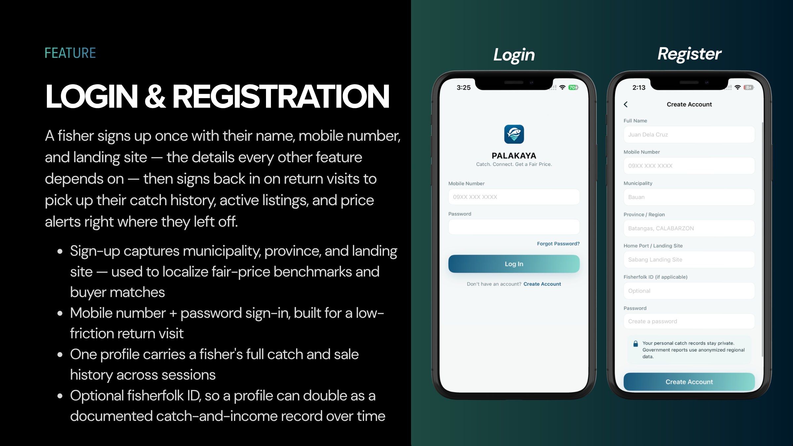
</div>

<br/>

- Sign-up captures full name, mobile number, landing site, municipality, and province — used to localize fair-price benchmarks and buyer matches.
- Mobile number + password sign-in, built for low-friction return visits, with **Keep me logged in** so the app opens straight to Home.
- Strong passwords are required (8+ characters with upper- and lowercase letters and a number), with a live checklist while typing.
- A five-step photo onboarding introduces the app, and a short, skippable welcome tour follows sign-up.
- One profile carries a fisher's full catch and sale history across sessions; an optional Fisherfolk ID field allows a profile to double as a documented catch-and-income record over time.

### 2. Digital Catch Logging

<div align="center">
  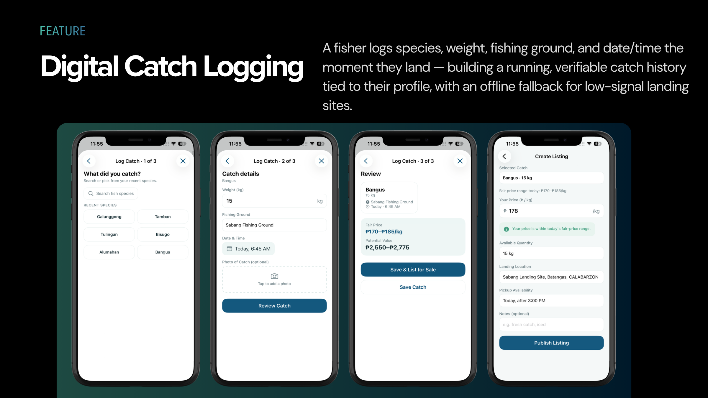
</div>

<br/>

A fisher logs species, weight, fishing ground, and date/time the moment they land — building a running, verifiable catch history tied to their profile, with an offline fallback for low-signal landing sites.

- Any fish can be logged: search the list, or type a species that isn't on it.
- An optional **photo** from the camera or gallery. It shows on the catch, and on the listing for buyers once uploaded.
- Catches can be **edited or deleted** later; deletes also reach the cloud on the next sync.

### 3. My Catch

<div align="center">
  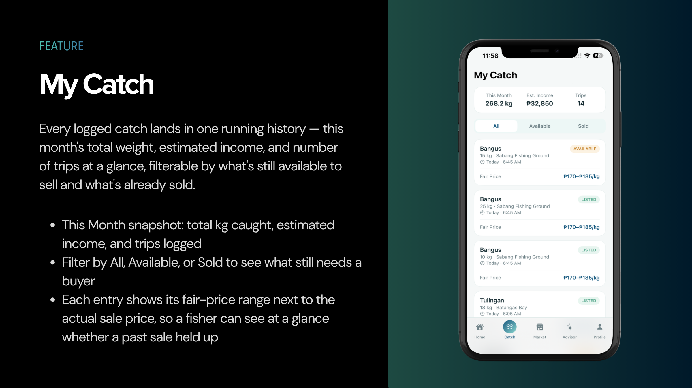
</div>

<br/>

- "This month" snapshot: total kilos caught, recorded sales, and days fished, all computed from the fisher's own records.
- Filterable by **All**, **Available**, or **Sold** to see what still needs a buyer.
- Each entry shows its fair-price range next to the actual sale price, so a fisher can see at a glance whether a past sale held up.

### 4. Fair-Price Benchmarking Engine

<div align="center">
  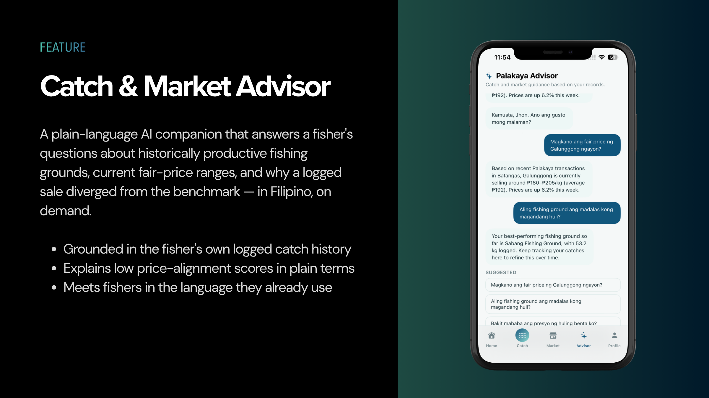
</div>

<br/>

- A rolling reference range per species, computed in the cloud from **real recorded sales in the last 30 days**: the middle 50% of sold prices (25th–75th percentile), with the median as the midpoint.
- A species gets a live range only once it has **at least 5 sales**, so no single fisher's price can be singled out. Until then the app shows a built-in regional **estimate** and labels it that way.
- Shown as a **range, not a single guess**, before the fisher ever agrees to sell. For example: "Fair price from 7 recent sales: ₱180–₱205/kg".
- **Per province:** the Fair Prices screen lets anyone pick a province. The fisher's own province is used first, then all Palakaya sales, then the estimate, and the screen always says which one it is showing, with a confidence level.

### 5. Marketplace Listing & Buyer Matching

<div align="center">
  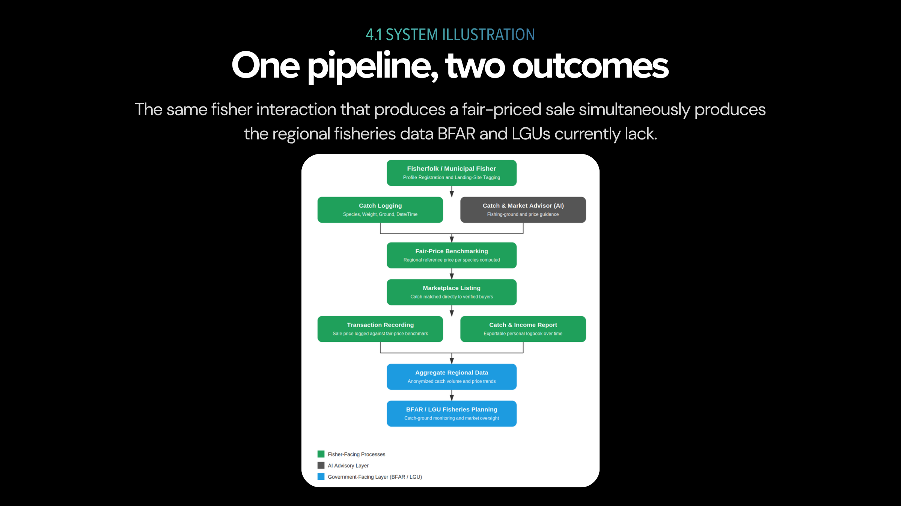
</div>

<br/>

- A fisher lists landed catch directly to verified vendors, retailers, and cooperatives — bypassing consignacion.
- Listings are matched by species, quantity, and proximity to the fisher's landing site.
- Offers are flagged **"within benchmark"** or **"below fair price"**; buyer verification status and ratings are visible up front.
- Listings can be searched by fish, seller or place and sorted by newest, lowest price, fair price first or most kilos. The fisher can call or text a buyer straight from the offer.

### 6. Transaction Recording & Price-Alignment Scoring

<div align="center">
  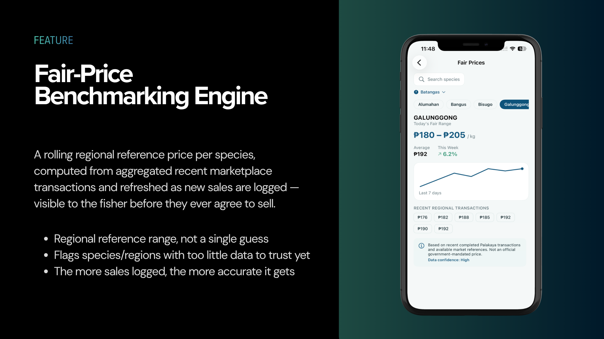
</div>

<br/>

- Once a fisher accepts a buyer's offer, the agreed price and quantity are recorded and instantly checked against the fair-price benchmark.
- Produces a **price-alignment score** for that sale — turning every completed transaction into a fairness check instead of a one-off, unverifiable exchange.
- Divergent sales are flagged and routed to the Catch & Market Advisor for a plain-language explanation.

### 7. Catch & Market Advisor (AI Companion)

<div align="center">
  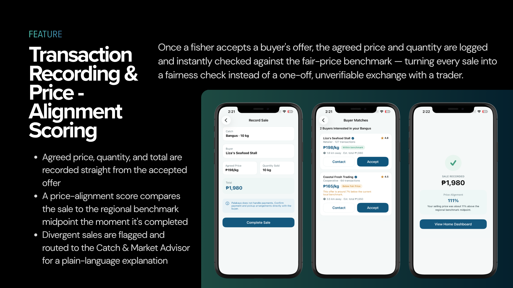
</div>

<br/>

- A real AI companion. The fisher can type any question, or tap a suggested one.
- Answers are grounded in the fisher's own catches and sales and the current fair-price ranges, and they cover productive fishing grounds, prices, and *why* a sale fell below the benchmark.
- Replies in the language the fisher writes in (Filipino, English, or Taglish), in 2–5 plain sentences. The Advisor says when a price is only an estimate and never invents prices, buyers, weather, or rules.
- **Free to run.** It uses Google Gemini's free tier through a Supabase Edge Function, so the AI key stays on the server and never ships in the app. Only signed-in fishers can use it.
- **Offline fallback.** With no signal, or when the free limit is reached, a built-in rule-based advisor answers from the same on-device data.
- **Guardrails.** It only answers fishing, catch, price, selling and app questions; it politely declines anything else, refuses to help with illegal fishing (blast, poison, fine-mesh nets, protected species), points to PAGASA, the Coast Guard and BFAR for safety and legal matters, never asks for money, PINs or IDs, and ignores attempts to change its rules.

### 8. Catch & Income Reports

<div align="center">
  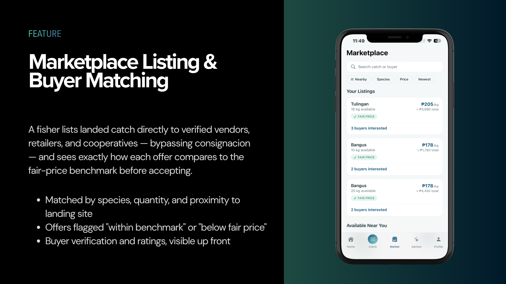
</div>

<br/>

- Consolidates a fisher's catch history, transaction log, and price-alignment trend into a savable, exportable personal report — monthly totals, average price alignment, and top species.
- Exportable and shareable on demand; the same records roll up into the BFAR/LGU aggregate reporting layer.

### 9. Buyer Accounts, Offers & Verification

- Anyone can register as a **buyer** (stall, retailer, carinderia or cooperative), browse fresh listings, and send a price offer with a quantity and a message.
- The fisher sees every offer side by side: buyer name, a **Verified** badge, number of paid purchases, and whether the offer is within the fair price. They accept one or decline.
- **Verification is done by a person, not the app.** An admin turns on the badge in Supabase after checking a business permit, cooperative registration or ID. The app itself can never set it.
- Once accepted, the buyer pays in the app through a **demo checkout** (GCash, Maya or LandBank) that mirrors the real steps (account number, one-time code, PIN, confirmation, receipt with a reference number) but moves no money. The fisher is notified when payment arrives.

### 10. Sea Today (weather and sea conditions)

- A Home card with today's temperature, sky, wave height, wind and chance of rain for the fisher's own town, from the free [Open-Meteo](https://open-meteo.com) forecast and marine APIs (no key needed).
- Turned into a plain guide for small boats: **Good to go**, **Be careful** or **Stay ashore**. The card's sky follows the conditions, its waves move with the real wave forecast, and a sunrise-to-sunset track shows the time of day.
- Compact by default; tap to open the full forecast. It always reminds fishers to follow PAGASA gale warnings and the Coast Guard.

### Profile, settings and demo tools

- Editable personal details, FishR ID and home port, a password change, live sync status with **Sync now**, and full Privacy, Help (FAQ) and About pages.
- **Appearance:** Auto, Light or Dark. Every screen has a complete Dark Mode in a deep night-sea navy.
- **Notifications** are built from real activity and open the related screen when tapped.
- **Demo Tools:** fill an account with sample catches that never upload, and replay the intro or welcome tour.

### Low-Bandwidth / Offline Entry

The app is **offline-first**. Catches, listings, and sales are saved on the phone right away, even with no signal at the landing site, and uploaded automatically on the next successful sync. A fisher can also tap the Wi-Fi button on Home to sync now. After login, the fisher's records download back from the cloud, so a reinstall or a new phone keeps their history. An SMS/USSD channel for phones without data is planned (see [Roadmap](#roadmap)).

---

## Implementation Status

What works in this build:

| Feature | Status in the iOS app |
|---|---|
| Register / log in (mobile + password), separate data per account | ✅ Working: local account plus Supabase Auth |
| Log catch (species search, weight, fishing ground, date & time) | ✅ Working |
| My Catch with filters and monthly totals | ✅ Working, from real records |
| Fair-price benchmark | ✅ Working: from real cloud sales (≥ 5), otherwise a labelled estimate |
| Create listing, with a warning when priced below the benchmark | ✅ Working |
| Marketplace of other fishers' listings, with search and Call / Text | ✅ Working, from the cloud |
| Buyer accounts: browse fresh catch, make offers, track them in My Offers | ✅ Working |
| Buyer verification (Verified badge set by an admin after checking a permit or ID) | ✅ Working |
| Buyer matches: fisher accepts or declines real offers, sale gets a price-alignment score | ✅ Working |
| Checkout with GCash, Maya or LandBank | ✅ Working as a **demo payment** (no real money moves) |
| AI Advisor | ✅ Working: Google Gemini (free) with guardrails and an offline fallback |
| Sea Today forecast (waves, wind, rain, go / careful / stay ashore) | ✅ Working, from Open-Meteo |
| Fair prices per province with a location picker | ✅ Working (run `005_regional_fair_prices.sql`) |
| Catch photos, shown on listings for buyers | ✅ Working (run `006_catch_photos.sql`) |
| Edit / delete catches, any species | ✅ Working |
| Keep me logged in, strong passwords, password change | ✅ Working |
| Dark Mode with an Appearance switch | ✅ Working |
| Photo onboarding, welcome tour, Demo Tools | ✅ Working |
| Notifications | ✅ Built from real sales, listings, sync status, and price updates; tap to open |
| Monthly report and share | ✅ Working, from real records |
| Cloud sync (upload and download) with row-level security | ✅ Working |
| Anonymized regional summary for BFAR / LGU (`regional_catch_summary`) | ✅ In the database; no dashboard yet |
| SMS / USSD entry | Future work, outside this project |

---

## System Illustration

<div align="center">
  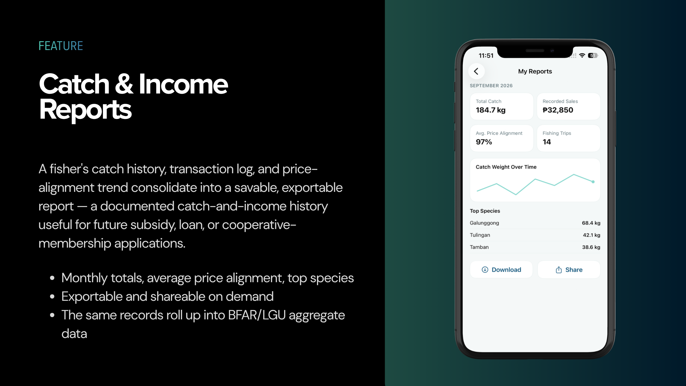
</div>

<br/>

The figure traces how a single fisher interaction becomes both a fisher-facing marketplace transaction and government-facing fisheries data. A fisher registers a profile and logs a catch by species, weight, ground, and date, while the Catch & Market Advisor concurrently analyzes historical patterns to recommend fishing grounds and expected prices. Both streams feed the fair-price benchmarking step, which informs a marketplace listing and a buyer match. Once a sale completes, it's recorded and checked against the benchmark to produce a price-alignment score, consolidated alongside the fisher's ongoing catch history into an exportable report. At the aggregate level, price-checked transaction data rolls up into anonymized regional data that informs BFAR and LGU fisheries planning — the same pipeline that helps a fisher get a fair price simultaneously produces the data government agencies currently lack.

---

## Scope & Boundaries

<div align="center">
  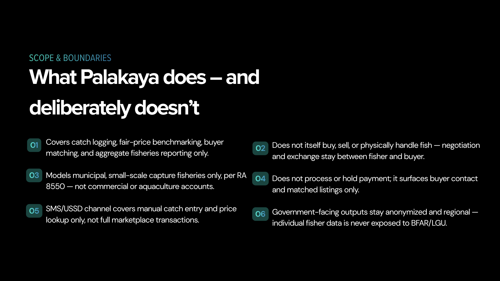
</div>

<br/>

**Palakaya does:**
- Cover catch logging, fair-price benchmarking, buyer matching, and aggregate fisheries reporting end-to-end.
- Model **municipal, small-scale capture fisheries only**, consistent with RA 8550's definition.

**Palakaya deliberately does not:**
- Itself buy, sell, or physically handle fish, negotiate, or mediate the exchange between fisher and buyer.
- Process real money. The in-app checkout (GCash, Maya, LandBank) is a **demonstration** that follows the real steps (account, one-time code, PIN, receipt) without contacting any payment provider; delivery is arranged directly between fisher and buyer.
- Extend to commercial fishing operators or aquaculture accounts.
- Expose individual fisher identities or raw transaction data to BFAR or LGU users — government-facing outputs are anonymized and aggregated at the regional level only.

---

## Tech Stack

| Layer | Technology |
|---|---|
| **iOS app** | Swift 5, SwiftUI (`@Observable`, `NavigationStack`, sheets), iOS 17+ |
| **On-device storage** | SwiftData (`@Model`), so the app works offline at the landing site |
| **Cloud database & login** | Supabase: Postgres, Auth, row-level security, and SQL views for the marketplace, fair prices, and regional reports |
| **AI Advisor** | Google Gemini (free tier), called from a Supabase Edge Function (Deno / TypeScript) |
| **Networking** | `URLSession` against Supabase's REST APIs, with no third-party packages |
| **Security** | Session tokens in the iOS Keychain, salted password hashes on device, API keys kept out of the repo |
| **Design** | Figma |

---

## Architecture (MVC)

```
 ┌──────────── View (SwiftUI) ────────────┐      ┌──────── Model ─────────┐
 │ Screens: Home, Catch, Market, Advisor, │      │ SwiftData @Model:      │
 │ Profile, Reports, Sales, Onboarding    │      │ UserAccount, CatchRecord│
 │ Only shows data and forwards taps      │      │ AdvisorMessageRecord   │
 └───────────────┬────────────────────────┘      │ + reference data       │
                 │ calls                         └──────────▲─────────────┘
 ┌───────────────▼──── Controller ─────────────────────────┐│ reads / writes
 │ AuthController · CatchController · MarketController     ├┘
 │ ReportsController · AdvisorController · SyncController  │
 │ NotificationsController                                 │
 └───────────────┬─────────────────────────────────────────┘
                 │ uses
 ┌───────────────▼──── Services ───────────────────────────┐      ┌──── Supabase ────┐
 │ SupabaseClient · SyncService · FairPriceService         │─────▶│ Postgres + Auth  │
 │ AppConfig · KeychainStore                               │      │ Edge Function ──▶ Gemini
 └─────────────────────────────────────────────────────────┘      └──────────────────┘
```

- **Models** hold data only (`Palakaya/Models`).
- **Views** never touch the database directly. They call a **Controller**, which applies the business rules: validation, price-alignment scoring, report totals, and sync. They show errors in a single alert.
- **Services** wrap the cloud: auth, upload and download sync, fair prices, and the AI Advisor call.

---

## Project Structure — iOS App

```
Palakaya/
├── Palakaya.xcodeproj/
├── Palakaya/
│   ├── App/            PalakayaApp (entry point, demo seed, keep me logged in), RootView, MainTabView, AppState
│   ├── Models/         UserAccount, CatchRecord, Offer, PaymentMethod, AdvisorMessageRecord, StaticData
│   ├── Controllers/    Auth, Catch, Market, Offer, DemoPayment, Reports, Advisor, Sync, Notifications, Demo
│   ├── Services/       SupabaseClient, SyncService, FairPriceService, WeatherService, AppConfig, KeychainStore
│   ├── Utilities/      InputParsing (mobile, weight, password rules), PasswordHasher, DateFormatting
│   ├── Components/     Theme (light/dark colors, buttons), SeaTodayCard, CatchPhotoPicker, SparklineChart
│   ├── Config/         Secrets.plist (git-ignored: Supabase URL + publishable key)
│   └── Views/
│       ├── Onboarding/ OnboardingView, LoginView, RegisterView, WelcomeTourView
│       ├── Home/       HomeView, NotificationsSheetView
│       ├── Catch/      MyCatchView, LogCatchFlowView, CatchDetailsView, EditCatchView
│       ├── Market/     MarketView, CreateListingView, ListingDetailsView, OtherListingDetailsView,
│       │               MakeOfferView, BuyerMatchesView, PriceExplorerView
│       ├── Offers/     BuyerOffersView
│       ├── Payments/   PaymentFlowView, PaymentReceiptView
│       ├── Sales/      RecordSaleView, SaleRecordedView
│       ├── Reports/    AdvisorView, ReportsView
│       └── Profile/    ProfileView, ProfileInfoView (details, landing site, privacy, help, about, demo tools)
├── supabase/
│   ├── schema.sql                   full database setup (tables, security, views)
│   ├── 002_market.sql               marketplace view (migration)
│   ├── 003_fair_prices.sql          fair prices from real sales (migration)
│   ├── 004_buyers_offers.sql        buyer accounts, verification, offers, demo payments
│   ├── 005_regional_fair_prices.sql fair prices per province
│   ├── 006_catch_photos.sql         catch photo storage and photos on listings
│   ├── seed_demo.sql                demo accounts and a month of data
│   ├── functions/advisor/index.ts   AI Advisor Edge Function (Gemini, with guardrails)
│   ├── Secrets.example.plist        template for Palakaya/Config/Secrets.plist
│   └── SETUP.md                     step-by-step cloud + AI setup
└── docs/
    └── Palakaya-Guide.md            full feature guide, finals changelog, build steps, demo script
```

The app is a 5-tab shell for fishers (**Home · Catch · Market · Advisor · Profile**) and a 4-tab shell for buyers (**Buy · My Offers · Advisor · Profile**), driven by one `AppState` observable object and a `NavigationStack` with a typed `Route` enum.

---

## Data Models

On-device SwiftData models (`Palakaya/Models`):

```swift
@Model final class UserAccount {
    var id: UUID
    var fullName: String
    var mobile: String            // normalized digits, e.g. 09172345678
    var passwordHash: String      // salted SHA-256, never plain text
    var municipality: String
    var province: String
    var landingSite: String
    var fisherfolkID: String
    var createdAt: Date
}

@Model final class CatchRecord {
    var id: UUID
    var ownerID: UUID?            // the account that logged it
    var species: String
    var weight: Double            // kg
    var ground: String
    var timeLabel: String
    var dateLogged: Date
    var statusRaw: String         // available | listed | sold
    var price: Double?            // ₱ per kg
    var saleAmount: Double?
    var buyerName: String?
    var alignment: Int?           // price-alignment score, % of the benchmark midpoint
    var buyersInterested: Int?
    var hasPhoto: Bool
    var needsSync: Bool           // true until uploaded to the cloud
}

@Model final class AdvisorMessageRecord {
    var id: UUID
    var ownerID: UUID?
    var isUser: Bool
    var text: String
    var timestamp: Date
}
```

On first launch the app seeds a demo fisher (`Mang Jose Dela Cruz`) with four sample catches, so it is explorable right away.

---

## Cloud Backend

Supabase (Postgres) tables, views and storage, defined in [`supabase/schema.sql`](supabase/schema.sql) and the numbered migrations:

| Object | What it holds | Who can read it |
|---|---|---|
| `profiles` | Name, mobile, municipality, province, landing site, role (fisher or buyer), verified badge | Only that fisher |
| `catches` | Every catch, listing, and sale, with an optional photo link | Only the fisher who owns it (row-level security) |
| `market_listings` (view) | Other fishers' listed catches: species, kg, price, first name, landing site, contact number | Signed-in users |
| `fair_prices` (view) | Per species, last 30 days of sales: p25 / median / p75, only when ≥ 5 sales | Signed-in users |
| `regional_fair_prices` (view) | Same as `fair_prices`, per province, for the location picker | Signed-in users |
| `offers` | Buyer offers on listings, their status and demo payments | The buyer and the fisher involved |
| Storage bucket `catch-photos` | Catch photos, each in a folder named after its owner | Anyone with the link; only the owner can upload or delete |
| `regional_catch_summary` (view) | Monthly totals by province and species for BFAR / LGU, anonymized, groups of ≥ 5 only | Signed-in users |
| Edge Function `advisor` | AI Advisor (Google Gemini) with topic and safety guardrails; checks the user is logged in | Signed-in users |

Weather for Sea Today comes straight from the free Open-Meteo API, not from Supabase. People who are not logged in cannot read anything in the database. Full setup steps are in [`supabase/SETUP.md`](supabase/SETUP.md).

---

## Design System

Colors come from the Palakaya logo (ocean blue, navy, sea teal) and are centralized in `Components/Theme.swift`.

| Token | Hex | Usage |
|---|---|---|
| `pkDark` | `#0261A7` | Primary brand: buttons, active states, gradient start |
| `pkNavy` | `#01447E` | Wordmark navy, gradient end, deep accents |
| `pkAqua` | `#2ED5CC` | Sea-teal accents, charts |
| `pkBg` | `#F5F8F8` | Page backgrounds |
| `pkSurface` | `#FFFFFF` | Cards, sheets |
| `pkSurface2` | `#EDF7F6` | Secondary surfaces, static rows |
| `pkText` | `#10272D` | Primary text |
| `pkSub` | `#667A80` | Secondary / muted text |
| `pkBorder` | `#DDE9E8` | Dividers, input borders |
| `pkSuccess` / `pkSuccessBg` | `#3E9C7D` / `#E7F5EF` | Positive status (e.g. within benchmark) |
| `pkWarning` / `pkWarningBg` | `#C9852B` / `#FCF2E1` | Caution status |
| `pkDanger` / `pkDangerBg` | `#C9483E` / `#FBEAE8` | Below-benchmark / error status |
| `pkInfo` / `pkInfoBg` | `#1F6FA3` / `#E7F1F7` | Informational callouts |

Buttons and text fields are at least 48–52 pt tall for easy tapping with wet or gloved hands.

---

## Figma Prototype

An interactive Figma prototype tracking the same flows is published at:

**[cod-wave-02815321.figma.site](https://cod-wave-02815321.figma.site)**

---

## Getting Started

### Prerequisites

- macOS with Xcode 15 or later (iOS 17 SDK or later) and an iOS Simulator runtime installed
  (Xcode → Settings → Components)
- Optional, for cloud sync and the AI Advisor: a free [Supabase](https://supabase.com) project and a free
  [Google AI Studio](https://aistudio.google.com/apikey) key

### Run the app

```bash
git clone https://github.com/jhonlloydval/Palakaya.git
cd Palakaya
open Palakaya.xcodeproj
```

Pick an iPhone simulator and press **⌘R**. Log in with the demo fisher: mobile `09172345678`, password `password`.

Without any setup the app runs **fully offline**: your data stays on the phone and the Advisor uses its built-in answers.

### Turn on the cloud and the AI Advisor (optional, free)

1. Follow [`supabase/SETUP.md`](supabase/SETUP.md) to create the database (run `schema.sql`, then `004_buyers_offers.sql`, then `006_catch_photos.sql`, then `seed_demo.sql` for demo data) and deploy the `advisor` function with your `GEMINI_API_KEY` secret.
2. Copy `supabase/Secrets.example.plist` to `Palakaya/Config/Secrets.plist` and fill in your Supabase URL and publishable key.
   That file is git-ignored, so keys never reach GitHub.

### Demo accounts

After running `supabase/seed_demo.sql`, these accounts work on any phone (password for all: **`password`**):

| Role | Name | Mobile | What to show |
|---|---|---|---|
| Fisher | Mang Jose Dela Cruz (Bauan) | `09172345678` | 3 offers waiting on his Tulingan listing: accept one, record the sale, see the alignment score |
| Fisher | Roberto Mendoza (Batangas City) | `09171110001` | Gets paid when Liza pays for his Galunggong |
| Fisher | Felicidad Reyes (Mabini) | `09171110002` | Alumahan listing with an offer |
| Fisher | Dindo Garcia (Mabini) | `09171110003` | Tulingan listing with two offers |
| Fisher | Rosario Aguilar (Lobo) | `09171110004` | Tamban listing with a below-fair offer |
| Buyer ✓ | Liza's Seafood Stall | `09181230001` | An **accepted offer ready to pay**: run the GCash / Maya / LandBank demo checkout (one-time code `123456`) |
| Buyer ✓ | Coastal Fresh Trading Cooperative | `09181230002` | Paid with LandBank; offers on listings |
| Buyer | Bay Fish Traders (not verified) | `09181230003` | Shows how an unverified buyer looks to fishers |
| Buyer ✓ | Ate Mila's Carinderia | `09181230004` | Paid with Maya; offers on listings |

The month of demo sales gives every main species (Galunggong, Tamban, Tulingan, Bisugo, Alumahan) a live fair price from at least 5 real sales.

---

## Roadmap

<div align="center">
  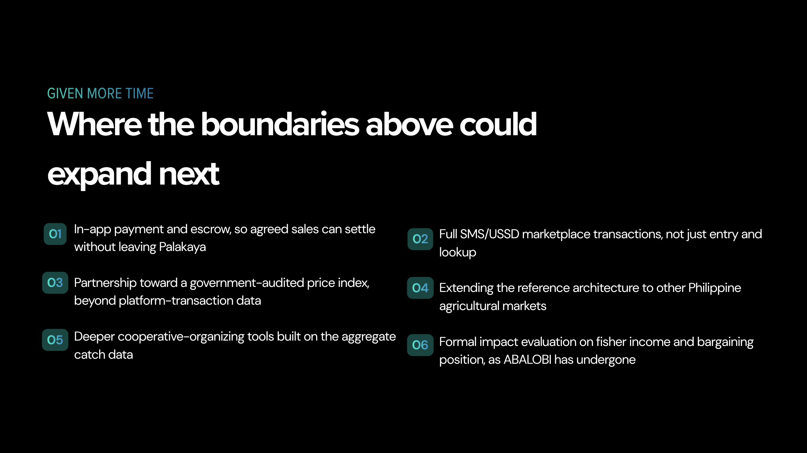
</div>

<br/>

| Feature | Status |
|---|---|
| **Mobile Application Development — Finals Requirement** | ✅ Completed |
| Fisher profile, catch logging, and catch history | ✅ Complete |
| Fair-price benchmarking from real sales | ✅ Complete |
| Marketplace listing & buyer matching | ✅ Complete |
| Transaction recording & price-alignment scoring | ✅ Complete |
| Buyer accounts, offers and admin-verified buyers | ✅ Complete |
| Demo checkout (GCash, Maya, LandBank) with receipts | ✅ Complete |
| Catch & Market Advisor (real AI with Google Gemini, guardrails, offline fallback) | ✅ Complete |
| Sea Today weather and sea forecast | ✅ Complete |
| Province fair prices, catch photos on listings | ✅ Complete |
| Dark Mode, photo onboarding, welcome tour | ✅ Complete |
| Catch & income report generation and sharing | ✅ Complete |
| Native SwiftUI iOS app (MVC) with offline storage | ✅ Complete |
| Cloud database, login, and two-way sync (Supabase, row-level security) | ✅ Complete |

**Beyond this project (future work):**

| Idea | Why it is outside this build |
|---|---|
| Real payments & escrow | Moving real money needs a licensed payment provider; the app ships a demo checkout instead |
| SMS/USSD access for phones without data | Needs a telecom short-code partner |
| BFAR / LGU dashboard on `regional_catch_summary` | The anonymized data is already collected; only the government-facing screen is left |

---

## References

<details>
<summary>Click to expand</summary>

- Beato, O. H. (2026, April 6). *Iran war pushes Philippines fishing communities to the brink.* The New Humanitarian.
- Cooperative Development Authority. (2021, August 9). *Fisherfolk marketing cooperatives: Empowered partners of BFAR towards fish sufficiency and food security.*
- Food and Agriculture Organization & WorldFish. (2020). *Information and communication technologies for small-scale fisheries (ICT4SSF): A handbook for fisheries stakeholders.* FAO.
- IndexBox. (2026, June 4). *Philippine fishermen crisis 2026: Declining catches, commercial vessels, fuel costs.*
- National Fisheries Research and Development Institute. (2024, May 20). *ISDApp: Empowering fisherfolk with accessible weather information.* Department of Agriculture.
- Philippine Institute for Development Studies. (2023). *Transforming Philippine agri-food systems with digital technologies* (Discussion Paper Series No. 2023-29).
- Philippine News Agency. (2026, January 12). *Protecting Filipino fishermen not an act of escalation, PH tells China.*
- Philstar.com. (2026, February 5). *Philippines fisheries near collapse as 45 million kilos lost annually.*
- Rappler. (2026, February 14). *Rappler Talk: What the world can learn from Philippine seas* [Interview with A. J. Ferrer].
- Regional Environmental Change. (2021). *Institutions and institutional changes: Aquatic food production in Central Luzon, Philippines.* 21(4), Article 127.
- Reuters. (2026, July 10). *A decade after historic ruling, Philippine fishermen say driven away from disputed shoal by China.* U.S. News & World Report.
- Stanford Center for Ocean Solutions. (2021). *Digital platforms empowering small-scale fishers.* Stanford University.
- Universitas Multi Data Palembang Student Conference. (2026). *FishLink: Bridging consumers direct to fishermen's catch* [Conference paper].

</details>

---

## License

Private and proprietary — capstone project. All rights reserved. Unauthorized use, reproduction, or distribution of any part of this codebase is strictly prohibited unless otherwise agreed with the author.

---

<div align="center">

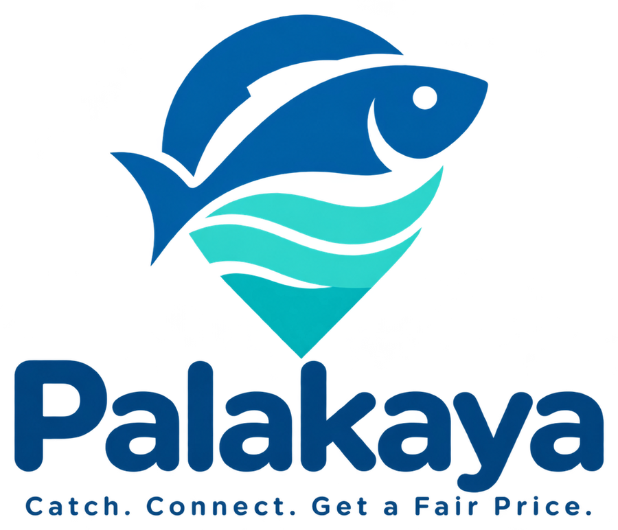

**Palakaya** — BSCS III Capstone, 2026 · Manuel S. Enverga University Foundation, Lucena City

</div>
